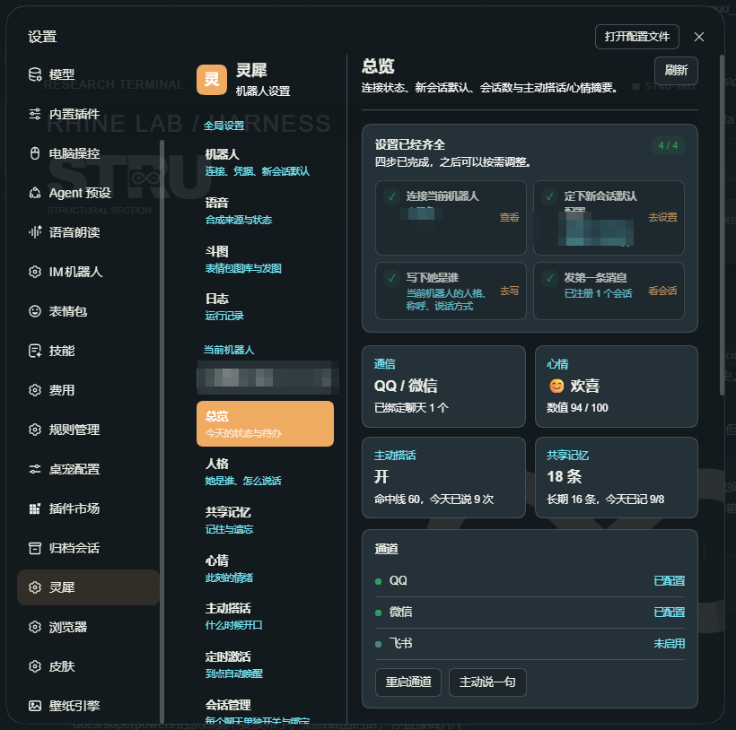
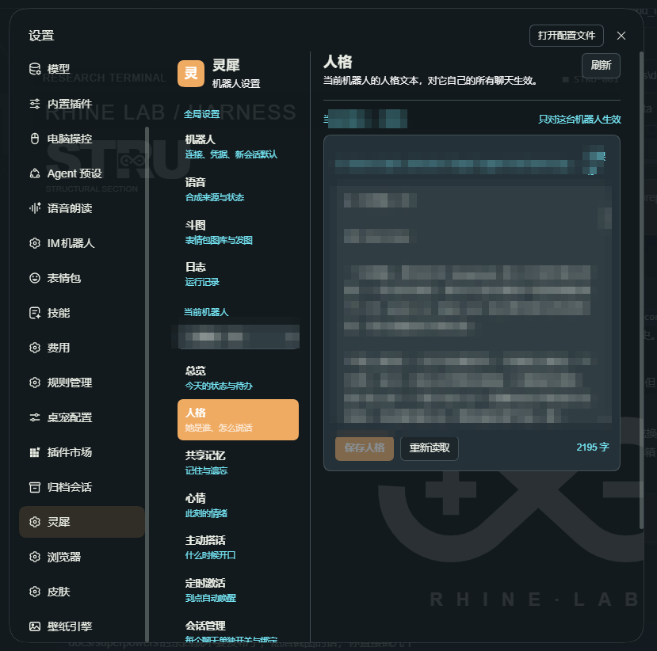
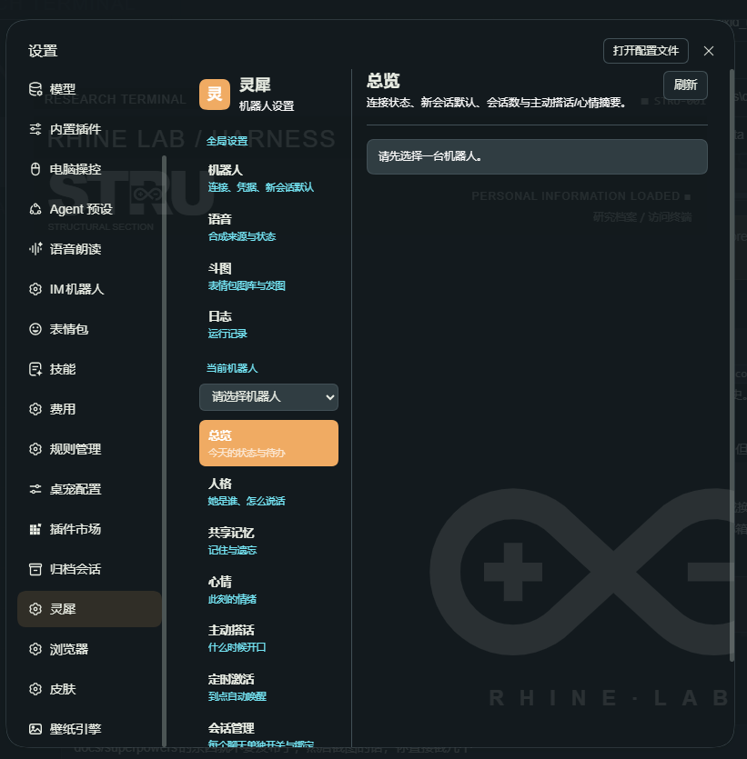

# 灵犀 · dsh-lingxi-agent-bot

> DeepSeek Harness（DSH）的陪伴插件：把 QQ 官方 Bot、飞书和自备的微信桥接，接成一台有**人格、共享记忆、心情和主动性**的机器人。


**TL;DR (English)** — A companion plugin for DeepSeek Harness. It bridges QQ (official bot API), Feishu and a bring-your-own WeChat bridge into DSH sessions, giving each bot its own persona, shared memory, mood, proactive messaging and self-scheduled reminders. Everything stays on your machine; the repo ships no credentials. UI and docs are in Chinese.

**机器人是唯一的连接与个体；每个聊天各自绑定一个 DSH 会话。**

插件只保留这一条结构：

```
QQ / 微信 / 飞书
      │ 独立机器人、独立凭据
      ▼
BotManager
      │ botId
      ├─ persona.md / memory.json / mood.json / proactive.json / schedule.json
      │
      ▼
聊天（私聊或群聊）── 1:1 ── DSH 会话
```

- 每台机器人有自己的连接、人格、共享记忆、心情和主动搭话；每个聊天还有自己的会话级主动搭话开关。
- 同一台机器人的多个聊天共享这些机器人级状态；不同机器人完全隔离。
- 聊天只承载该聊天的历史、上下文和 DSH 权限，不拥有机器人的人格。
- 没有通道级人格、全局心情、全局主动搭话或固定通道会话。

> 模块职责、边界与设计取舍见 [docs/mechanisms.md](docs/mechanisms.md)；字段级现状与数据模型见 [docs/communication-and-data-model.md](docs/communication-and-data-model.md)。

## 截图

> 截图里的机器人名与本地路径已打码。

**总览** —— 连接状态、四步引导，以及心情 / 主动搭话 / 共享记忆的实时摘要：



**人格** —— 每台机器人一份人设文本，只对这台机器人的聊天生效：



**设置页** —— 全局设置与当前机器人两组入口：



## 前置要求

- 已安装并可正常启动的 **DeepSeek Harness（DSH）**（开发与回归基于 `0.2.1-rc.2`）。
- **Node.js ≥ 20**：DSH 自带运行时，通常不用另装；自己跑测试才需要。
- 一个可用的模型 provider（在 DSH 侧配置，插件不内置任何密钥）。
- 各通道自己的资质：
  - **QQ**：腾讯官方 Bot 的 AppID / AppSecret（扫码创建）。
  - **飞书**：可创建设备注册的自建应用。
  - **微信**：没有官方个人号协议，需自备桥接（见 [examples/wechat-bridge.mjs](examples/wechat-bridge.mjs)）。

## 安装

### 从 GitHub 安装

```powershell
dsh plugin add github:liaoqihua/dsh-lingxi-agent-bot
```

装完重启 DSH，打开 **设置 → 灵犀**。若入口没出现，去 **设置 → 插件** 确认 `dsh-lingxi-agent-bot` 已启用。

### 本地开发

```powershell
git clone git@github.com:liaoqihua/dsh-lingxi-agent-bot.git
cd dsh-lingxi-agent-bot
pnpm install
dsh plugin add link:<本仓库绝对路径>
```

`link:` 安装把 profile 指向工作副本，改完代码重启 DSH 即生效（`dsh-hot-reload` 在场时前端改动可热更新）。

### 网络受限时

部分网络会拦 GitHub 的 22 端口（表现为 `ssh: connect to host github.com port 22: Connection timed out`，而 HTTPS 也可能不通）。这时让 SSH 走 443，只影响当前仓库：

```powershell
git config core.sshCommand "ssh -p 443 -o HostName=ssh.github.com"
```

## 接入机器人

打开 **设置 → 灵犀 → 机器人 → 接入机器人**。

三个通道统一为：

```
生成接入二维码 → 扫码 / 授权 / 验证 → 创建机器人 → 进入机器人详情
```

| 通道 | 接入方式 | 成功后才创建 |
| --- | --- | --- |
| QQ | 腾讯官方扫码 Bot，官方 SDK 建立连接 | 拿到 AppID/AppSecret 并连接成功 |
| 飞书 | `registerApp` 设备注册，验证 tenant token 和 bot info | 应用身份验证完成 |
| 微信 | iLink 扫码、状态轮询，必要时提交配对码 | 保存 token/accountId/baseUrl 并可调用原生发送 |

切换通道或取消接入会终止当前任务，不会留下机器人或后台轮询。微信出站文本使用授权 token 调用原生 `sendmessage`。

重复接入同一台机器人会按通道稳定凭据去重（QQ/飞书看 AppID，微信看 accountId）：接入页报错并退回机器人列表，不会落成第二条记录。

## 设置页导航

导航按「全局设置 → 当前机器人」分组：

```
全局设置
  ├─ 机器人           连接与凭据、机器人个体、新会话默认配置（私聊 / 群聊两段）
  ├─ 语音             全插件共用的合成来源与状态、提示词（折叠）、试听
  ├─ 斗图             表情包图库、转图状态与发送规则
  └─ 日志             插件自己的运行记录
当前机器人  [选择器]
  ├─ 总览 / 人格 / 共享记忆 / 心情 / 主动搭话 / 定时激活
  ├─ 会话管理         这台机器人的所有会话：分组、开关、换绑
  └─ 语音条（仅 QQ）   这台机器人能把语音条发到哪些聊天
```

- 「机器人」「语音」「斗图」「日志」是全局的（不属于任何一台机器人），放在最上面的全局设置区。
- 机器人选择器和它自己的页面在同一组里：换了机器人，这一组的页面就跟着换。
- **会话管理**是独立页面，管的是「已经存在的聊天」；新会话怎么建在「机器人 → 新会话默认配置」里。
- **语音条**只在选中 QQ 官方 Bot 机器人时出现：webhook / 飞书通道没有 `sendVoice`，这两类机器人没有语音条能力。

### 机器人

1. **连接与凭据**：扫码、重连、连接测试。
2. **机器人个体**：名称、**她怎么叫你**、消息处理、上下文增强、访问名单。

**上下文增强**（默认关）只决定要不要附上「渠道 / 发送者 / 会话 / 增强提示」这些来源字段。**时间不在这个开关里**：每条入站消息都带一段 `<companion_context>`，开头的 `now`（日期 + 星期 + 时分秒 + 时区）和 `part_of_day` 永远都在——模型看不到时钟就会自己猜，把「今天」说成「明天」。这些字段只是给模型看的背景：回灌历史、记忆提炼和心情判断都会先用 `spokenTextOf()` 把这段剥掉，不会把 `now:` 当成对方说的话。
3. **新会话默认配置**：拆成「私聊」和「群聊」两块，各含工作区、Agent Preset、Provider/Model、默认权限。

**她怎么叫你**是按机器人存的（`bots.json` 的 `ownerName`），留空则回落到插件级 `identity.ownerName`（默认「主人」）。它决定三件事：QQ 私聊的对方名字与会话标签（官方 SDK 不给昵称，只能取这里）、心情判断提示词里的称呼、记忆里记对方时用的名字。群聊一律用真实发言人昵称，微信 / 飞书的对方名字来自桥接侧，都不受这个设置影响。改完当场生效：已有 QQ 私聊的标签会立刻刷新，不用等对方下一条消息。

已有会话自己的模型、Preset 和 DSH 权限不会被换绑悄悄改写；默认配置只用于之后新建的会话。

### 会话管理

- **主动搭话的所有开关都在这一页**：顶上一个是这台机器人的「主动搭话总闸」，下面每个会话行里一个自己的开关。
- 总闸关掉后，所有会话都不会自己开口（手动「主动搭话 → 现在说一句」仍然可用）；总闸开着时，只有「这个会话也开着」的那些才会被挑中。
- **主动语音的开关也在这里**（和主动搭话同构）：一张「主动语音总闸」卡片 + 每个会话行里的「主动语音」勾。总闸是全插件共用的 `voice.promptEnabled`，关掉后每行的勾都不生效；每个聊天的勾存在 `record.voicePrompt.enabled`，**私聊默认开、群聊默认关**（群里突然冒出一条语音比多一行文字打扰，想开就按那个会话开）。
- 只有 QQ 官方 Bot 有语音条：选中微信 / 飞书机器人时这张卡片只给说明，不出现开关。
- 按私聊 / 群聊分组列出这台机器人的所有会话：名字、peerId、会话 id、通道、最近活跃、消息数。
- 每个会话可以单独开关主动搭话、开关主动语音、换绑到别的 DSH 会话。**冷却不在这里**：它是「主动搭话」页上的机器人级参数，一个值管全部会话。
- 会话名是自动的（按通道 + 对方昵称生成，入站时跟着对方昵称更新），这一页不提供改名。
- 断开连接也能看和改——会话记录与通道状态无关。
- 「刷新候选会话」会绕过缓存重新扫一遍宿主会话目录；平时打开这一页走缓存，不重复扫。

### 语音（全局）

- **合成状态**：当前配置会走哪个来源（借宿主「语音朗读」路由，还是自己的 OpenAI 兼容 TTS）、该来源是否可用、模型 / 音色 / 格式 / 超时、API Key 是否已设置、临时目录里有没有残留文件。
- **合成来源设置**（折叠）：来源判定、TTS 地址 / API Key / 模型 / 音色 / 格式。折起来时摘要就写着「现在会走哪个来源 + 音色 + 格式」，不用展开也能确认。
- **主动语音提示词**（折叠）：提示词框里默认就填着内置规则，可以直接在上面改（上限 2000 字）；改回默认点「恢复默认规则」。与默认一字不差时按「使用默认规则」存（`voice.prompt` 为空串），以后改默认规则也会跟着生效。旁边显示上次发语音的时间。**开不开不在这页**——总闸和每个聊天的开关都在「会话管理 → 主动语音」里。
- 默认规则里的分寸：撒娇 / 想念 / 安慰 / 被夸 / 道晚安直接发；只说 10~60 字的口语短句，不念代码网址列表；发语音时正文只留一两个字或干脆不写；不连着两条都发，刚发过 10 分钟内会补一句「这一轮先用文字」；对方说正事时用文字。
- 注入只对 QQ 官方 Bot 的聊天生效（其它通道没有语音条）；关掉「启用语音合成」时注入会改成一句「别调 companion_voice」，避免模型白试。
- **试听**：随便说一句即可合成并在浏览器里直接播，同时给出格式与大小。
- 这一份合成设置是**全插件共用**的（`config.json` 的 `voice` 段）；「发给谁、发得出去吗」是机器人级的，见下一节。

### 语音条（当前机器人，仅 QQ）

- 只有 QQ 官方 Bot 能把音频作为一条语音发出去；选中非 QQ 机器人时这个页面不会出现在导航里。
- **通道状态**：这台 QQ 机器人是否已连接 / 已绑定（带 AppID）、最近一次连接错误。
- **合成是否可用**：直接反映全局那一段设置（关着、或宿主朗读路由不可用时这里会提示去全局页修）。
- **主动语音**：显示这台机器人的语音注入是开是关（默认规则 / 自定义规则），以及上次发语音是什么时候；具体开关在「会话管理 → 主动语音」。
- **可发语音的聊天 N / 总数**：列出这台机器人的 QQ 聊天，标出哪些已经拿到回复目标（先在 QQ 里说句话才有）。
- **发送**：选一个聊天（没目标的在列表里标注并禁用）→ 合成并发出语音条；发送失败会把通道给的原因显示出来。
- 模型侧同一个能力是 `companion_voice` 工具，也只能发到这台机器人的 QQ 聊天。

### 斗图（全局）

- **状态**：总开关（把 `[表情: 描述]` 发成原生图片）、图库数与可用图片数、已转成图片的张数、配不上的描述数，以及最近一次发送/没配上的记录。
- **发送规则**：QQ 官方 Bot、微信（iLink）、飞书都会把配上的表情包作为原生图片消息发出；配不上的描述会被丢掉，只在日志里留一条「表情包没配上图库：…」。单轮最多几张在这里选（1–4）。
- **图库**：列出扫描到的图库（名称、id、张数、分类）。图库来自 dsh-meme，本插件只读它的索引。
- **发送方式**（自动 / 纯文字 / 图片）仍归 dsh-meme 自己的设置页管，这里不重复一份。
- 找不到图库时页面会直接列出「找过哪些位置」，方便把图库放到正确目录（通常是 `~/.dsh/meme-packs`）。

### 新会话默认配置与会话

- 每个聊天第一次收到消息时，按它自己的 scope（私聊 / 群聊）在对应的那一段里取值建会话：工作区是唯一来源，没有第二处兜底。
- 缺字段不会静默回落：设置页保存时，缺工作区的那一段**不提交**（页面上会写明缺哪一段、这次只存了哪些），其余个体设置照常保存；**新建会话**时缺工作区会往那个聊天回一句带原因的提示。
- 这个门槛只管「新建」：已经绑定了会话的聊天用自己的目录，配置缺失也照常恢复、照常回话（不会因为「新会话默认」没填就被连带掐断）。
- 新建会话后在首轮 `followup` 前完成 `Workspace.attachSession` 和唯一归属校验。
- 手动换绑：先在「机器人 → 新会话默认配置」里给这个 scope 选好工作区并保存，再到「会话管理」挑这个工作区里的已有会话。
- 历史上未归组但 cwd 匹配的会话也能候选，绑定成功后正式归组。
- 跨工作区、已占用和子代理会话不能绑定。

新会话默认权限来自 `sessionDefaults[scope].defaultPermission`（默认 `workspace-write`，可改为 `read-only` 或 `danger-full-access`）。已有会话保留自己的权限记录。

## 机器人级模块

### 人格

路径：`bots/<botId>/persona.md`。

只编辑当前机器人的完整人格文件，并注入这台机器人的所有聊天会话。普通非机器人会话不注入这份人格。

### 共享记忆

路径：`bots/<botId>/memory.json`。

- 同一台机器人的所有聊天共享一份长期记忆。
- 支持按轮次提炼、证据召回、鲜活度衰减、长期事实和 factKey 取代。
- 页面直接按 botId 读取，不按聊天拆成多份。
- 普通非机器人会话不回退读取其他记忆目录。

### 心情

路径：`bots/<botId>/mood.json`。

- 每台机器人一份心情状态。
- 注入按 `sessionId + updatedAt` 去重，换到新会话后仍能注入当前心情。
- 同一台机器人的每日注入上限共享；不同机器人互不影响。
- 没有机器人时，没有心情状态或全局兜底。

### 右下角心情挂饰

- 机制与素材来自 MIT 许可的 `dsh-feiyu-mood`，适配为「只属于某台机器人的会话」。
- 页面右下角出现可拖动的挂饰，点开显示这台机器人的数值、情绪条和完整时间线。
- **只在该会话是机器人的会话时才显示**：浏览器半侧（`client.js` 注册的 `shell.overlay` 项）广播当前主视图会话 id，挂饰拿它问 `GET /api/companion/session`，判定不属于机器人就一个节点都不进 DOM；切到别的会话会自动收起，切回来再出现。
- 因此不需要选机器人：挂饰显示的就是这个会话所属的那台机器人。
- 宿主路由：`/api/companion/widget.js`、`/api/companion/widget/<图片>`；脚本通过 `webserver/index-inject` 注入页面。

### 主动搭话

路径：`bots/<botId>/proactive.json`（只放机器人级参数与统计）。

- 这一页只调**这台机器人的节奏与文案**：多久掷一次、命中线、没中加成、安静时段、空闲门槛、冷却、每日上限、触发文案；下面跟着搭话统计（命中线/今天开口次数/上次骰子/连没中）和这台机器人的尝试日志。
- **开关不在这里**：总闸和每个会话的闸门都在「会话管理」里（总闸 = `proactive.json` 的 `enabled`，会话闸门 = `sessions.json` 的 `record.proactive.enabled`）。
- **在哪个聊天里开口由会话级开关决定**；私聊新会话默认开，群聊新会话默认关。
- **冷却也只有这一个**（机器人级，`proactive.json` 的 `cooldownMinutes`）：它同时限制「这台机器人多久能再开口」和「刚开口过的那个会话先歇着」；挑会话时按“开着开关 + 最近有人说话 + 不在冷却里”降序取第一个。
- **开口时正文自带时钟**：主动搭话是插件直接往会话里塞一条消息，没有宿主准备的回合上下文，模型看不到「现在几点」就会自己猜，说出错的时间。所以消息正文除了那句触发文案，还会带一段上下文：当前日期星期时分秒 + 时区、时段（傍晚/深夜…）、对方最后一条消息是多久前、我上次在这里主动开口是多久前；并写明「这是我自己想开口，不是对方刚发来的消息」。定时激活同理，正文里也会给「现在几点」。
- 没有机器人时，不运行主动搭话循环。

### 定时激活

路径：`bots/<botId>/schedule.json`。

- 一条定时任务就三样东西：**提交时间**、**等待间隔**（分钟）、**任务内容**。到点后灵犀把任务内容重新激活到目标聊天——像收到一条新消息那样处理，回复照常通过通道发回那个聊天。
- 谁都能定：模型在聊天里用 `companion_schedule` 给自己定，人在设置页「定时激活」里直接提交。两边写的是同一份记录。
- 重复：`repeat_minutes`（页面上「重复间隔」）不为 0 时，每次激活后按这个间隔排下一次；为 0 就是一次性任务，激活后变成「已激活」。
- 页面上一行一条记录：状态、目标聊天、任务内容、**提交时间**、**等待间隔**、下次激活（还有多少分钟）、已激活次数；失败会显示原因。
- 每条记录可以「立即激活」「取消」「删除」：取消只改状态（记录留着），删除才真的抹掉。
- 到点时如果那个会话正在跑别的回合，这一条**不排队也不计失败**，15 秒后的下一个 tick 再看——晚几分钟没人在意，插进正在说的半句话里才是打扰。
- **重启不丢**：任务写在磁盘上，插件启动时立刻补一次到点的（之后每 15 秒一次）。补发之前会等机器人通道就绪——QQ 要等长连接真的连上，飞书/微信只要配置齐；否则会出现「跑完一轮、回复却发不出去」。重复任务的下一次时间也一起存着。
- 会话拉不起来（工作区/配置缺失等）连续 3 次就自动停用并记下原因。
- **确实没赶上就不硬来**：到期后超过 24 小时都没激活（进程一直没开、或机器人一直没连上）标成「没激活成功」，不再补；停用的机器人、被删掉的聊天也是先等，等不到才记失败。删除机器人会连同它的任务一起删掉。
- 定时激活的那一轮不参与记忆提炼和心情判断：那是它自己定的任务，不是对方说的话。

## 设置与删除

全部状态都在 DSH 的数据目录下（默认 `~/.dsh/dsh-lingxi-agent-bot/`），不随插件代码分发：

- `bots.json`：机器人注册表（身份、对方称呼、凭据、两段新会话默认配置）。
- `bots/<botId>/`：人格、记忆、心情、主动搭话、定时任务（`schedule.json`）和语音发送记账（`voice.json`，用来控制主动语音的节奏）。
- `sessions.json`：聊天与 DSH 会话的唯一绑定，含每会话的主动搭话开关。
- `config.json`：插件级默认值、语音设置和斗图开关。
- `meme-state.json`：斗图的发送统计（转成图片的张数、最近一次没配上的描述）。
- `voice/`：临时语音文件。
- `logs/diag.log`：诊断日志。

移除机器人会断开连接并删除它的配置和状态目录；DSH 会话本身不删除。

## 模型工具

| 工具 | 作用 |
| --- | --- |
| `memory_remember` | 给当前机器人记一条长期记忆 |
| `memory_search` | 搜索当前机器人的记忆 |
| `memory_forget` | 软删除当前机器人的一条记忆 |
| `mood_status` | 查看当前机器人的心情 |
| `persona_get` | 读取当前机器人的人格 |
| `persona_set` | 改写当前机器人的人格 |
| `companion_send` | 往当前机器人绑定的聊天发消息 |
| `companion_schedule` | 给自己定一个定时任务：等待间隔 + 任务内容，到点重新激活到这个聊天 |
| `companion_schedule_list` | 看当前机器人的定时激活记录（内容 / 提交时间 / 等待间隔 / 下次激活） |
| `companion_schedule_cancel` | 取消一条还没激活的定时任务 |
| `companion_voice` | 合成语音并通过当前 QQ 官方 Bot 发出（气氛合适时主动发） |
| `companion_status` | 查看当前机器人的连接、心情、主动搭话和记忆 |

工具注册进宿主后，模型就能看到全部工具（名字、说明、参数），所以插件不需要在提示词里再列一遍。它补的是另外两件事，由一段必需的注入 `companion:capabilities` 承担：

- **什么时候用**：工具说明讲「是什么、怎么调」，不讲「该不该用」；这一段按能力分组给一句时机（记忆该记什么、语音什么时候发、定时任务什么时候排）。
- **这会儿哪些用不了**：语音要 QQ 官方 Bot + 合成开着 + 这个聊天没关主动语音；缺哪一样就写进「现在用不了」，免得模型反复撞同一个错，或绕过用户在「会话管理」里关掉的开关。
- 普通 DSH 会话里这些工具也在工具表里（注册是全局的），那一段会换成一行「只在机器人聊天里可用，不要调用」。
- 清单里的工具名和真正注册的工具由测试核对，两边不允许漂移。

## 设置页 API

| 方法 | 路径 | 作用 |
| --- | --- | --- |
| GET | `/api/companion/state` | 机器人、工作区、会话（插件自己的记录）和各模块摘要 |
| GET | `/api/companion/sessions?botId=&refresh=` | 宿主会话目录里可作为换绑候选的那些会话（按需 + 缓存） |
| GET | `/api/companion/session?sessionId=` | 这个会话属于哪台机器人（`bound` / `botId` / `botName`）；挂饰用它决定显不显示 |
| POST | `/api/companion/config` | 保存插件级默认值和语音设置 |
| GET/POST | `/api/companion/bots` | 接入、更新（含两段新会话默认校验）、删除、扫码、取消、配对码、换绑会话、会话改名与开关（`chat.update`）、连接测试 |
| GET/POST | `/api/companion/persona?botId=` | 读写当前机器人的人格 |
| GET/POST | `/api/companion/memory?botId=` | 读写当前机器人的共享记忆 |
| GET/POST | `/api/companion/mood?botId=` | 读取/重置当前机器人的心情 |
| GET/POST | `/api/companion/proactive?botId=` | 读取/更新/触发当前机器人的主动搭话 |
| GET/POST | `/api/companion/schedule?botId=` | 读取当前机器人的定时任务记录（含目标聊天与上限）；`create` / `cancel` / `remove` / `toggle` / `fire` |
| POST | `/api/companion/channels/restart` | 重启机器人连接 |
| GET | `/api/companion/presets` | Agent Preset 目录 |
| GET | `/api/companion/models` | 模型目录 |
| GET | `/api/companion/voice` | 全局合成状态自检：来源判定、宿主朗读路由是否可用、临时目录 |
| GET | `/api/companion/voice?botId=` | 这台机器人的 QQ 通道状态 + 可发语音条的聊天（`ready` = 有回复目标） |
| POST | `/api/companion/voice` | 合成一句；带 `sendTo`（可加 `botId` 校验归属）就发成 QQ 语音条 |
| GET | `/api/companion/diag` | 诊断日志 |
| GET | `/api/companion/widget.js` | 右下角心情挂饰脚本 |
| GET | `/api/companion/widget/<图片>` | 挂饰形象图与五档表情 |
| GET | `/api/companion/widget/status` | 只读诊断：挂饰脚本是否已注入页面 |

## 开发与自检

```powershell
cd dsh-lingxi-agent-bot
node --test
node --check index.js
node --check client.js
```

当前回归：**170 项测试通过**（含定时激活、重启竞态、能力清单、挂饰、注入健康、语音注入、时间上下文与图片类型嗅探用例）。

界面文案约定：`client.js` 上的文字只写**说明性文本**——这个开关/字段是什么、改了会发生什么、数据存在哪；不写解释性文本（为什么这样设计、以前怎样、和别的插件对比、内部实现名）。

核心文件：

```
index.js                       BotManager、注入、回合钩子、工具与 API 装配
client.js                      机器人设置页 + 挂饰的会话广播（shell.overlay）
lib/bots.js                    机器人注册表与状态目录
lib/bot-manager.js             独立连接与扫码入口
lib/channel-provisioning.js    飞书/微信扫码状态机
lib/weixin-api.js              微信 iLink 登录与原生文本发送
lib/session-bridge.js          聊天 ↔ DSH 会话、Workspace 挂接
lib/persona.js                 机器人人格注入
lib/capabilities.js            能力清单注入（有什么工具、什么时候用、这会儿哪些用不了）
lib/memory.js                  机器人共享记忆
lib/mood.js                    机器人心情与跨会话注入
lib/voice-prompt.js            语音提示词注入（主动发语音）与发送记账
lib/proactive-bots.js          机器人主动搭话
lib/time-context.js            注入正文的时间上下文（入站消息 + 主动搭话/定时激活）
lib/schedule.js                定时激活（记录 + ticker + 激活链路）
lib/widget.js                  右下角心情挂饰（路由 + index 注入）
assets/widget/                 挂饰形象、五档表情与浏览器脚本
lib/channels/qq-official.js    QQ 官方 Bot
lib/channels/webhook.js        微信出站与通用桥接
lib/channels/feishu.js         飞书事件与发送
```

## 隐私与安全

- **凭据只落在本机**：AppID / AppSecret / 微信 token / 飞书密钥全部写在 `~/.dsh/dsh-lingxi-agent-bot/` 的配置文件里，不随代码分发，也不上传到任何第三方；只在向对应平台发起请求时用于鉴权。
- **仓库里没有真凭据**：测试全部使用假值（`secret-123`、`wxid_1` 之类），`node_modules/` 与内部过程文档不入库。
- **数据不出机器**：人格、记忆、心情、定时任务、语音临时文件都是本机文件。模型调用走你自己在 DSH 里配的 provider，插件不代理、不转发、不内置密钥。
- **会话权限由你定**：新建会话使用你配置的默认权限（示例是 `workspace-write`），插件不会自行提权，也不会绕过你在「会话管理」里关掉的开关。
- **主动开口是可关的**：主动搭话有总闸 + 每聊天闸门 + 安静时段 + 每日上限；定时激活有记录页可以随时取消。

## 免责声明

- 本项目是第三方插件，**与腾讯、字节跳动、飞书、微信官方无关**，也未获其背书。
- 平台接口可能随时变更或收紧，届时相关通道可能不可用；请自行关注平台条款并合规使用。
- 微信没有官方个人号协议：示例只提供桥接骨架，用第三方协议的账号风险由使用者自行承担。
- 主动搭话与定时激活会**以你的名义**往聊天里发送消息，请自行控制频率与开关。
- 软件按 MIT 许可「按原样」提供，不附带任何担保。

## 许可

MIT，见 [LICENSE](LICENSE)。第三方来源与许可见 [THIRD_PARTY_NOTICES.md](THIRD_PARTY_NOTICES.md)。
